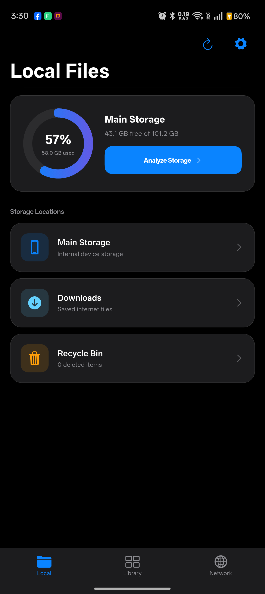
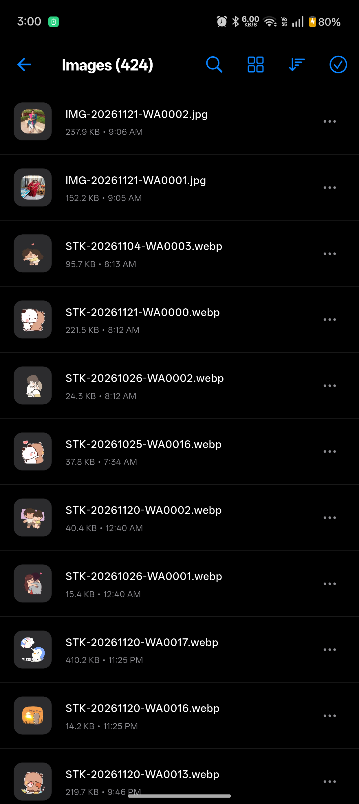

<p align="center">
  
</p>

<h1 align="center">AeroFiles</h1>
<p align="center">
  <b>A modern, high-performance file manager and local network media player for Android.</b><br>
  <i>Designed with clean OLED dark aesthetics, native SMB network storage streaming, built-in video playback, and Recycle Bin data protection.</i>
</p>

<p align="center">
  <a href="https://github.com/ASHISDEY1998/aerofiles/releases/latest/download/AeroFiles.apk">
    
  </a>
</p>

<p align="center">
  <a href="https://github.com/ASHISDEY1998/aerofiles/releases"></a>
  
  
  
  
  
</p>

---

## 📲 Direct Download & Quick Install

Get the official, standalone Release APK directly on your phone:

### 📥 **[Download AeroFiles.apk (Direct Install)](https://github.com/ASHISDEY1998/aerofiles/releases/latest/download/AeroFiles.apk)**
* **File Size:** ~101 MB
* **Version:** v1.0.6 (Build 7)
* **Compatibility:** Android 8.0 (Oreo) to Android 15+

#### How to Install on Android:
1. Tap the **[Download AeroFiles.apk](https://github.com/ASHISDEY1998/aerofiles/releases/latest/download/AeroFiles.apk)** link.
2. Once the download completes, tap the notification or open the file from your **Downloads** folder.
3. If prompted with *"Install unknown apps"*, tap **Settings** and allow installation for your browser.
4. Tap **Install** and launch **AeroFiles** from your home screen.

---

## 📸 Screenshots

<p align="center">
  
  &nbsp;&nbsp;
  
  &nbsp;&nbsp;
  
</p>

<p align="center">
  
  &nbsp;&nbsp;
  
  &nbsp;&nbsp;
  
</p>

---

## 🌟 Key Features

### 🎬 1. Universal Video & Audio Engine
* **Broad Format Support:** Play popular video formats (MP4, MKV, AVI, MOV, FLV, WMV, WebM, TS) directly inside the app.
* **Hardware Acceleration:** Smooth decoding supporting HEVC (H.265 HDR), AV1, VP9, and H.264.
* **Subtitles & Audio:** Embedded and external subtitle support (SRT, ASS, SSA) and multi-audio track switching.
* **Zero-Download Network Streaming:** Stream media files over local Wi-Fi networks with instant byte-range seeking.

### 🌐 2. Local Network Storage (SMB, WebDAV, SFTP)
* **Home Server Connection:** Connect to local home servers, NAS devices, and shared network storage.
* **Large Drive Navigation:** Browse multi-terabyte drives with folder hierarchy and breadcrumb navigation.
* **Two-Way Transfers:** Copy or move files between internal storage and local network drives.
* **Access from PC:** Built-in local Wi-Fi web server to manage phone files from a computer browser.

### 📊 3. Storage Overview & Visual Analyzer
* **Accurate Hardware Metrics:** Live storage capacity meter showing exact gigabytes used and free.
* **Visual Breakdown:** Multi-color circular breakdown for Videos, Images, Audio, Documents, and Applications.
* **Space Management:** Quickly identify large files and temporary cache items.

### 🗑️ 4. Safe Recycle Bin with Restore
* **Accidental Deletion Protection:** Move files safely to the Recycle Bin and restore them anytime to their original location with one tap.
* **System Media Synchronization:** Synchronizes with Android media storage on delete, trash, and restore.
* **Configurable Preferences:** Set default deletion behavior to ask each time, move to Recycle Bin, or delete permanently.

### 🎨 5. Clean Interface & Theming
* **Dual Themes:** Pure OLED Dark Mode and clean Light Mode.
* **In-App Gallery:** High-resolution image viewer with pinch-to-zoom and swipe gallery.
* **Batch Operations:** Multi-select toolbar for sharing, copying, moving, renaming, and deleting files.

---

## 🛠️ Tech Stack

* **Framework:** [Flutter](https://flutter.dev) (Dart 3)
* **Media Engine:** `media_kit` + `libmpv`
* **Protocols:** `dart_smb2` (SMB 2/3), `dartssh2` (SFTP), WebDAV & HTTP
* **Native Android Layer:** Kotlin with Android storage APIs

---

## 🏗️ Build from Source

```bash
# 1. Clone repository
git clone https://github.com/ASHISDEY1998/aerofiles.git
cd aerofiles

# 2. Fetch packages
flutter pub get

# 3. Build standalone Release APK
flutter build apk --release

# 4. Build Release App Bundle (.aab)
./gradlew :app:bundleRelease
```

---

## 📄 Privacy & License

* **Privacy:** AeroFiles operates strictly on-device and over your local network. No personal telemetry or data tracking is collected.
* **License:** Licensed under the [MIT License](LICENSE).
