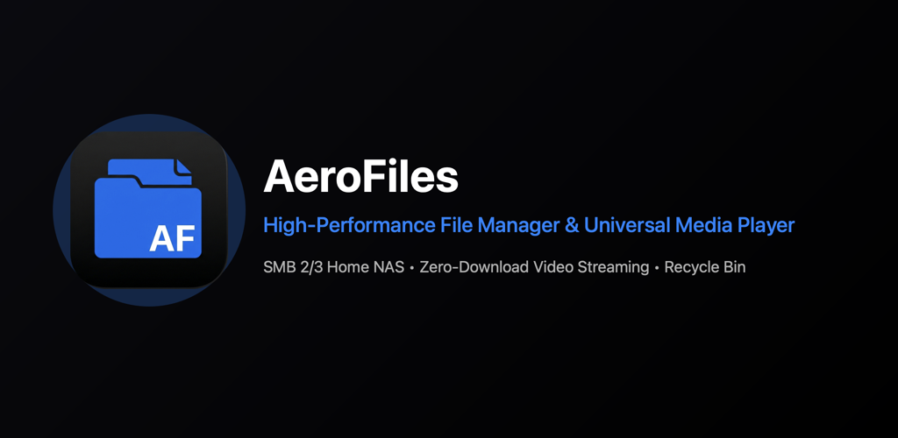
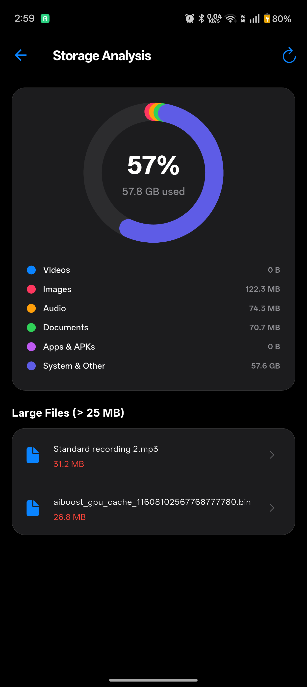
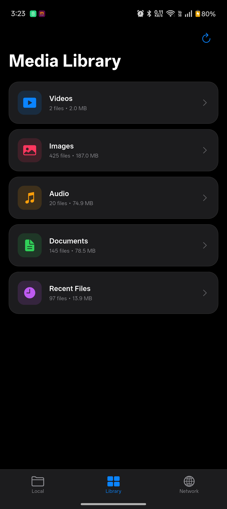
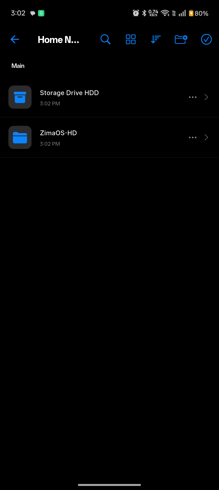
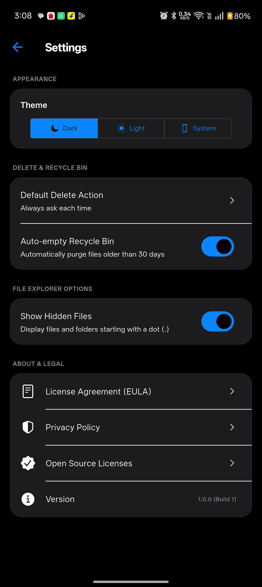

<p align="center">
  
</p>

<h1 align="center">AeroFiles</h1>
<p align="center">
  <b>A modern, high-performance file manager and local network media player for Android.</b><br>
  <i>Designed with clean OLED dark aesthetics, hardware AES-256 Safe Vault, native SMB/SFTP network streaming, built-in universal video playback, and Recycle Bin data protection.</i>
</p>

<p align="center">
  <a href="https://github.com/ASHISDEY1998/aerofiles/releases/latest/download/AeroFiles-arm64-v8a.apk">
    
  </a>
</p>

<p align="center">
  <a href="https://github.com/ASHISDEY1998/aerofiles/releases"></a>
  
  
  
  
  
  
</p>

---

## 📲 Direct Downloads (v1.0.13 / Build 14)

Download the official standalone release for your device architecture:

| Package | Architecture / Target | Download Link | Size | Description |
| :--- | :--- | :---: | :---: | :--- |
| **AeroFiles (arm64)** | **64-bit ARM (`arm64-v8a`)** | [📥 **Download**](https://github.com/ASHISDEY1998/aerofiles/releases/latest/download/AeroFiles-arm64-v8a.apk) | **~34 MB** | **Recommended** for 99% of modern phones and tablets |
| **AeroFiles (armv7)** | 32-bit ARM (`armeabi-v7a`) | [📥 **Download**](https://github.com/ASHISDEY1998/aerofiles/releases/latest/download/AeroFiles-armv7.apk) | **~32 MB** | Legacy Android devices |
| **AeroFiles (x86_64)** | 64-bit Intel/AMD (`x86_64`) | [📥 **Download**](https://github.com/ASHISDEY1998/aerofiles/releases/latest/download/AeroFiles-x86_64.apk) | **~39 MB** | Chromebooks & Android Emulators |
| **AeroFiles (Universal)**| All Architectures | [📥 **Download**](https://github.com/ASHISDEY1998/aerofiles/releases/latest/download/AeroFiles.apk) | **~102 MB** | Universal fat APK containing all native binaries |
| **AeroFiles App Bundle** | Android App Bundle (`.aab`) | [📥 **Download**](https://github.com/ASHISDEY1998/aerofiles/releases/latest/download/AeroFiles.aab) | **~154 MB** | Signed bundle for Google Play Console publishing |

* **Android Compatibility:** Android 8.0 (Oreo) to Android 15+

---

## 📸 Screenshots

<p align="center">
  
  &nbsp;&nbsp;
  
  &nbsp;&nbsp;
  
</p>

<p align="center">
  
  &nbsp;&nbsp;
  
  &nbsp;&nbsp;
  
</p>

---

## 🌟 Comprehensive Feature Highlights

### 🎬 1. Universal Video & Audio Engine
* **Broad Container & Codec Support:** Play MKV, MP4, AVI, MOV, FLV, WMV, WebM, TS, M2TS, VOB, 3GP, and MPEG transport streams directly without third-party players.
* **Hardware Accelerated Decoding:** Seamless playback for HEVC (H.265 10-bit HDR), AV1, VP9, and H.264 up to 4K 60fps.
* **Bluetooth Multipoint & Call Auto-Pause:** Integrates with native Android `AudioManager` and `ACTION_AUDIO_BECOMING_NOISY`. When a phone call rings or Bluetooth earbuds switch focus to another device, video playback automatically pauses and smoothly resumes when the call ends.
* **Subtitles & Multi-Audio Track Switching:** Load embedded soft subtitles (SRT, ASS, SSA) or external subtitle files with customizable styling, font size, and track selection.
* **Intuitive Gestures & Controls:** Swipe left for brightness, swipe right for volume, double-tap to seek ±10s, pinch-to-zoom, aspect ratio toggling (Fit, Crop, Stretch, 16:9, 4:3), and picture-in-picture (PiP).
* **Playback Memory:** Remembers timestamp position and prompts "Resume Playback from MM:SS?" on launch.

---

### 🛡️ 2. Safe Vault (Hardware AES-256 & Stealth Mode)
* **AES-256-CTR Streaming Encryption:** Files moved into the Safe Vault are encrypted block-by-block using AES-256-CTR with individual 16-byte cryptographically secure random IVs.
* **Android MediaScanner Exclusion:** Encrypted vault files live inside a shielded `.aerofiles_vault/` folder containing `.nomedia`. Moving a photo or video into the vault notifies Android's `MediaScanner` to instantly scrub it from **Google Photos**, **Gallery**, and third-party media pickers.
* **Complete Stealth Privacy Mode:** By default, the Safe Vault tile is invisible throughout the entire app (Internal Storage, file browsing, and tablet sidebars). It only becomes visible when explicitly enabled in **Settings → Security & Privacy**.
* **Custom Password/PIN + Fingerprint Quick-Unlock:** Configured with its own distinct 4-digit PIN (independent of your phone lock pattern), with biometric fingerprint authentication for instant access.
* **Zero-Leak Decrypted Previews:** Decrypts to temporary cache only during active viewing, and automatically purges all decrypted preview files from storage when exiting the vault.
* **One-Tap Restore:** Seamlessly decrypts files back to their exact original folders and triggers `MediaScanner` so they instantly reappear in your gallery.

---

### 📁 3. Media Library with Parent-Folder Segregation (Cx Style)
* **Parent-Folder Grouping:** In the Videos and Photos sections, media files are organized by their immediate parent directory (e.g. `Camera`, `Screenshots`, `WhatsApp Video`, `Movies`, `Downloads`, `Instagram`).
* **Visual Folder Cards:** Shows thumbnail previews, item counts, aggregated folder sizes, and last modified dates.
* **Quick View Toggle:** Switch seamlessly between **By Folder** and **All Files** modes with a single tap.
* **Deep Category Filtering:** Dedicated tabs for Videos, Images, Audio, Documents, Applications (APKs), and Archives (ZIP/RAR/7Z).

---

### 🌐 4. Local Network Storage (SMB, SFTP, WebDAV & Wi-Fi Server)
* **SMB 2/3 Protocol Support:** Connect directly to Windows shared folders, Samba shares, TrueNAS, Unraid, Synology, and QNAP network attached storage.
* **SFTP / SSH Storage:** Secure file transfers over SSH using password or private key authentication.
* **WebDAV Support:** Connect to Nextcloud, ownCloud, and local WebDAV storage drives.
* **Zero-RAM Chunked Streaming Uploads:** Multi-gigabyte videos stream in 64 KB chunks directly to SMB, SFTP, and WebDAV servers with zero RAM overhead, completely preventing OutOfMemory errors and packet drops.
* **Safe Move Semantics:** When moving files from device to network drives, local source files are strictly retained until the remote destination write is verified and complete.
* **Zero-Download Remote Streaming:** Stream multi-gigabyte high-bitrate movies directly from your home NAS with byte-range seeking over local Wi-Fi.
* **PC Web Transfer Server:** Built-in lightweight HTTP server allows browsing, uploading, and downloading phone files from any desktop browser on the local network.

---

### 🛡️ 5. Background File Operations & Floating Progress Bubble
* **Floating Live Transfer Progress Bubble:** An animated glassmorphic bubble appears at the bottom right whenever file transfers begin. Tapping it opens a dedicated screen showing per-item progress bars, transfer speeds (MB/s), total megabytes, and cancel controls.
* **Foreground Service Ongoing Notification:** File operations (copying, moving, downloading multi-gigabyte folders) are bound to an ongoing notification (`FOREGROUND_SERVICE_DATA_SYNC`) showing live progress bars, speed, and an instant Cancel button so Android never kills the task.
* **4-Second "Undo" Action on Delete:** Accidental deletions trigger a floating 4-second banner allowing one-tap recovery without visiting the Recycle Bin.
* **Duplicate File Detector:** Built into the Storage Analyzer, identifying duplicate files sharing identical byte sizes and MD5/CRC32 checksums to reclaim wasted storage.
* **Accidental Deletion Protection (Recycle Bin):** Deleted files are safely stored in `.aerofiles_trash/` with atomic same-mount renames and can be restored anytime to their original location.

---

### 📱 6. Tablet, Foldable & Desktop UX
* **Two-Pane Split View (Landscape):** On tablets, foldables, and Samsung DeX, a landscape two-pane layout displays directory categories on the left (30%) and the file browser grid on the right (70%).
* **Hardware Keyboard Shortcuts:**
  * <kbd>Space</kbd>: Quick Preview
  * <kbd>Delete</kbd> / <kbd>Backspace</kbd>: Move to Recycle Bin
  * <kbd>Cmd</kbd> / <kbd>Ctrl</kbd> + <kbd>A</kbd>: Select All
  * <kbd>Cmd</kbd> / <kbd>Ctrl</kbd> + <kbd>C</kbd> / <kbd>V</kbd>: Copy / Paste

---

### ⚡ 7. Ultra-Fast Disk-Persistent Thumbnail Cache
* **Instant Disk-Cached Loading:** Scaled video thumbnails are cached directly to `context.cacheDir/thumbnails/` using MD5 hash & file modification timestamp keys. On app launch, thumbnails load in `<1ms` with zero CPU decode spikes.
* **Two-Tier Architecture:** Combines a 100-item compact in-memory L1 LRU cache with an L2 persistent disk cache.
* **Strict Resource Guardrails:** Automatic LRU pruning bounds cache size at 60 MB or 1,500 files, and in-flight request deduplication prevents redundant background decodes.

---

## 🛠️ Tech Stack & Architecture

| Layer | Technologies |
| :--- | :--- |
| **Framework** | [Flutter](https://flutter.dev) (Dart 3) |
| **Media Player Engine** | [`media_kit`](https://pub.dev/packages/media_kit) + native [`libmpv`](https://mpv.io) |
| **Network Protocols** | [`dart_smb2`](https://pub.dev/packages/dart_smb2) (SMB 2/3), [`dartssh2`](https://pub.dev/packages/dartssh2) (SFTP), WebDAV & HTTP |
| **Cryptography** | [`pointycastle`](https://pub.dev/packages/pointycastle) (AES-256 CTR), [`crypto`](https://pub.dev/packages/crypto) (SHA-256, MD5) |
| **Biometrics & Security** | [`local_auth`](https://pub.dev/packages/local_auth) (`FlutterFragmentActivity`) |
| **Native Android Layer** | Kotlin with Android storage APIs, `AudioManager`, `ThumbnailUtils`, `MediaMetadataRetriever` |
| **UI Design System** | Custom Cupertino-inspired OLED Dark Mode & Clean Light Mode (`AppleTheme`) |

---

## 🏗️ Build from Source

### Prerequisites
* Flutter SDK (3.24.0 or higher)
* Android SDK (API 34 / 37) & NDK (28.2+)
* Java 17

### Instructions
```bash
# 1. Clone repository
git clone https://github.com/ASHISDEY1998/aerofiles.git
cd aerofiles

# 2. Fetch Flutter packages
flutter pub get

# 3. Run Static Code Analysis & Unit Tests
flutter analyze --no-fatal-infos
flutter test

# 4. Build Split per-ABI Release APKs (~34 MB each)
flutter build apk --split-per-abi

# 5. Build Google Play App Bundle (.aab)
./gradlew :app:bundleRelease
```

---

## 🤝 Contributing

Contributions, issues, and feature requests are welcome! Please check the [Contributing Guidelines](CONTRIBUTING.md) before submitting a Pull Request.

---

## 📄 Privacy & License

* **Privacy First:** AeroFiles operates strictly on your local device and home network. No user telemetry, crash reports, or personal data are ever collected or sent to external servers.
* **License:** Licensed under the [MIT License](LICENSE).
